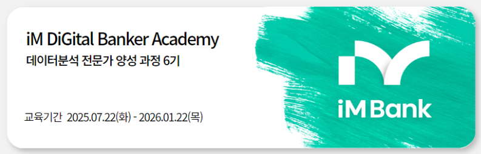

<div>
  
</div>

# 통합 세그먼트 레이더 (iM ONEderful Segment Radar)

iM뱅크 디지털 뱅커 아카데미 6기(데이터분석 전문가 양성과정) 최종 프로젝트입니다. 1조 iM ONEderful 팀이 2025.12.23부터 2026.01.22까지 진행했습니다.

법인 고객을 세그먼트(업종 × 지역 × 등급 × 전담 여부)로 묶어 월별 KPI 6개를 1~3개월 앞까지 예측하고, 예측과 실적의 차이로 조기경보를 만들고, 변화 요인과 다음에 할 일(Next Best Action)을 제안하는 Python 파이프라인입니다. 결과는 HTML 대시보드와 월간 1페이지 PDF 리포트로 나옵니다.

## 문제와 목표

기획서(`docs/[iM뱅크 6기][1조]최종 프로젝트 기획서.pdf`)에서 정리한 배경은 다음과 같습니다.

- 법인 고객 운영이 월간 실적 리포트 중심이라, 세그먼트별 실적 둔화나 이탈 조짐을 발생한 뒤에야 알아차리는 경우가 많다.
- 업종·지역·등급에 따라 반응 시점이 다른데, 어느 세그먼트를 이번 달에 먼저 관리할지 정하는 우선순위 체계가 약하다.
- 외환·무역금융은 환율 국면(추세·변동성)에 따라 기회와 리스크가 빠르게 바뀌어 별도의 관리 체계가 필요하다.

그래서 "예측 → 조기경보 → 원인 설명 → 액션 추천"을 하나의 흐름으로 묶은 세그먼트 운영 레이더를 만들고, 환율 국면 기반 FX 모듈을 확장으로 붙이는 것을 목표로 했습니다.

## 주요 기능

| 단계 | 내용 | 주요 코드 |
|------|------|-----------|
| 패널 구축 | 고객 단위 월별 자료를 세그먼트-월로 합산하고, 빈 달을 채운 전체 패널을 만듦 | `src/imradar/data/preprocess.py` |
| KPI 계산 | 예금총잔액, 대출총잔액, 카드총사용, 디지털거래금액, 순유입, FX총액과 파생 지표(한도소진율 등) | `src/imradar/features/kpi.py` |
| 예측 | KPI별·예측 시점(1/2/3개월)별 LightGBM 모델 18개. lag·rolling·변화율 피처, 선택적으로 거시경제 지표 | `src/imradar/models/forecast_lgbm.py` |
| 조기경보 | 전월 기준 1개월 예측과 실적의 잔차 비율로 급감/급증/변곡을 판정하고 워치리스트를 만듦 | `src/imradar/models/residual_alerts.py` |
| 원인 설명 | LightGBM 피처 기여도(`pred_contrib`)로 경보 세그먼트의 주요 요인을 문장으로 요약 | `src/imradar/explain/lgbm_contrib.py` |
| 액션 추천 | 예측 변화·경보·세그먼트 특성으로 규칙 점수를 매겨 우선순위 액션 제안 | `src/imradar/recommend/` |
| FX 레이더 | 환율 국면(추세 × 변동성) 판정과 세그먼트별 FX 기회·리스크 점수 | `src/imradar/models/fx_regime.py` |
| 산출물 | HTML 대시보드, 월간 1페이지 PDF, 드리프트(PSI) 점검 | `src/imradar/pipelines/`, `src/imradar/ops/` |

## 처리 흐름

```
은행 제공 CSV ─┐
               ├─ 세그먼트-월 패널 → KPI 계산 → 피처 생성 → LightGBM 예측(1~3개월)
거시 지표 CSV ─┘                                                │
                                         ┌──────────────────────┼──────────────────────┐
                                         ▼                      ▼                      ▼
                                 잔차 기반 경보·워치리스트   피처 기여도 설명        규칙 기반 액션 추천
                                         └──────────────────────┴──────────────────────┘
                                                                ▼
                                              대시보드(HTML) · 월간 리포트(PDF)
```

전체 흐름은 `code/scripts/run_mvp.py` 하나로 실행됩니다.

## 기술 스택

- Python 3.10 이상(3.11에서 확인), pandas, NumPy, scikit-learn, SciPy
- LightGBM (기본 예측 모델), SHAP
- Plotly (HTML 대시보드), ReportLab (PDF)
- 선택: XGBoost·CatBoost·Optuna (앙상블 실험), PyTorch (LSTM·Transformer·TFT 실험)
- pytest, ruff

## 결과

저장소에 커밋된 세그먼트 패널(`code/outputs/segment_panel.parquet`)과 학습된 모델(`code/outputs/models/lgbm_*_h{1,2,3}.pkl`)로 `code/scripts/evaluate_models.py`를 다시 실행해 얻은 값입니다. 평가 구간은 2024-01~2024-12 기준월이고, 예측 대상은 변환된 값(순유입은 signed log1p, 나머지는 log1p)입니다.

| KPI | R² (1개월) | R² (2개월) | R² (3개월) | RMSE (1개월, 변환 척도) |
|-----|-----------:|-----------:|-----------:|------------------------:|
| 카드총사용 | 0.875 | 0.850 | 0.827 | 0.602 |
| 예금총잔액 | 0.840 | 0.797 | 0.772 | 1.155 |
| FX총액 | 0.829 | 0.827 | 0.825 | 0.110 |
| 대출총잔액 | 0.813 | 0.752 | 0.714 | 1.728 |
| 디지털거래금액 | 0.813 | 0.768 | 0.739 | 1.421 |
| 순유입 | 0.124 | 0.065 | 0.047 | 2.961 |

- 평가 행 수는 1개월 21,151, 2개월 19,149, 3개월 17,162입니다.
- 패널은 세그먼트 2,038개 × 36개월(2022-01~2024-12), 73,368행입니다.
- 2024-12 기준 워치리스트는 44건입니다(`code/outputs/dashboard/03_risk_watchlist.html`).
- 순유입은 입금과 출금의 차이라 부호가 바뀌고 변동이 커서 설명력이 낮습니다.
- 발표 자료(`code/docs/MODEL_SUMMARY.md` 등)에 적힌 카드총사용 86.3%, 예금총잔액 83.1%, 순유입 13.4%는 위 재계산 값과 다릅니다. 그 값을 어떤 모델과 데이터로 계산했는지는 저장소에 기록이 없습니다.

대시보드는 `code/outputs/dashboard/`에 있습니다. `index.html`에서 시작해 경영 요약(00), 전체 현황(01), 성장 예측(02), 리스크 워치리스트(03), 액션(04), FX 레이더(05), 성과 종합(06) 7개 페이지로 이동합니다.

## 실행 방법

은행 원본 데이터와 외부 거시 지표 CSV는 저장소에 없습니다. 원본 없이 실행할 수 있는 것은 테스트, 저장된 모델 평가, 드리프트 점검입니다.

```bash
cd code
python -m venv .venv
source .venv/bin/activate
pip install -r requirements-dev.txt

pytest                                   # 단위 테스트
python scripts/evaluate_models.py        # 저장된 모델 재평가 → outputs/model_evaluation.csv
python scripts/monitoring_report.py      # 최근 6개월 대비 PSI 점검 → outputs/monitoring/
```

원본 CSV가 있으면 전체 파이프라인을 실행할 수 있습니다. 자세한 옵션과 산출물은 [code/README.md](code/README.md)에 있습니다.

```bash
python scripts/run_mvp.py --raw_csv <iMbank_data.csv.csv 경로> --external_dir <외부 데이터 폴더>
```

## 팀

| 이름 | GitHub | 역할 (기획서 기준) |
|------|--------|--------------------|
| 김수민 | [sumin9716](https://github.com/sumin9716) | 프로젝트 매니저, 모델 개발, 인사이트 |
| 나효상 | [TimePise](https://github.com/TimePise) | 데이터 수집, EDA, 풀스택 |
| 배수원 | - | 문서화, 시각화 |
| 서범창 | [SeoBamm](https://github.com/SeoBamm) | 모델 개발, EDA, 풀스택 |

저장소 커밋 기록으로 확인되는 기여는 다음과 같습니다. 그 밖의 작업(데이터 수집, EDA, 발표 준비 등)은 커밋으로 남아 있지 않습니다.

- 서범창(SeoBamm): 저장소 초기 구성, 진행 체크리스트, 과정 가이드라인 문서, 간트 차트
- sumin9716: 기획서 PDF 업로드, 체크리스트 갱신
- `sumin` 이름의 커밋(2026-01-19): `code/` 아래 파이프라인 코드, 산출물, 문서 대부분
- 작성자 정보가 없는 계정(GitHub User)의 커밋(2025-12-23): `code/`의 최초 MVP 코드

## 한계

- 원본 데이터가 저장소에 없어 `run_mvp.py` 전체 실행 결과는 이 저장소만으로 재현할 수 없습니다.
- R²와 RMSE는 log1p/signed log1p로 변환한 척도에서 계산한 값입니다. 코드가 계산하는 SMAPE는 0~2 범위의 비율입니다. 카드총사용 1개월 평가에서는 대상의 약 50%가 실제값 0이라 SMAPE가 1.17로 나옵니다. 발표 자료의 "SMAPE 1.17%"는 이 비율을 퍼센트로 적은 것입니다.
- `add_rolling_features`는 세그먼트별로 한 달 미룬 값에 rolling을 세그먼트 구분 없이 적용하므로, 각 세그먼트의 처음 몇 달(창 길이 - 1개월)은 앞 세그먼트의 값이 섞인 평균·표준편차가 됩니다. 결과를 위치 기준 인덱스로 되돌려 넣기 때문에 입력 행이 (세그먼트, 월) 순서로 정렬되어 있지 않으면 다른 행에 값이 들어갑니다. 저장된 모델이 이 피처로 학습되어 있어 고치려면 원본 데이터로 다시 학습해야 합니다.
- `run_mvp.py`의 계층 조정(`reconcile_forecasts`, `method="mint"`)은 상위 수준의 별도 예측 없이 하위 합계를 목표값으로 쓰기 때문에 조정량이 항상 0입니다. 음수 예측을 0으로 바꾸는 효과만 있는데, 기본 실행에서는 조정 대상 KPI(예금·대출·카드·디지털·FX)의 예측이 역변환 단계에서 이미 0 이상이라 결과가 바뀌지 않습니다.
- 드리프트 점검의 PSI는 기준 기간과 현재 기간을 각각 다른 구간 경계로 나눠 계산하므로, 분포가 그대로 이동한 경우를 잡지 못합니다.
- 딥러닝 실험(`scripts/deep_learning_models.py`)의 R²는 원 단위 값을 표준화해 계산하므로 위 LightGBM 표와 직접 비교할 수 없습니다.
- 발표 자료(`code/docs/PRESENTATION_GUIDE.md`)의 시스템 아키텍처·기술 스택 슬라이드에 나오는 Django 백엔드와 React 프론트엔드는 이 저장소에 포함되어 있지 않습니다.

## 폴더 구조

```
.
├── code/                    # 파이프라인 코드 (자세한 내용은 code/README.md)
│   ├── src/imradar/         # 데이터·피처·모델·설명·추천·대시보드 모듈
│   ├── scripts/             # 실행 스크립트 (run_mvp.py 등)
│   ├── tests/               # 합성 데이터 단위 테스트
│   ├── outputs/             # 커밋된 패널, 모델, 대시보드, 리포트
│   └── docs/                # 발표·시연 가이드, 모델 요약, 월간 리포트 템플릿
├── docs/
│   ├── [iM뱅크 6기][1조]최종 프로젝트 기획서.pdf
│   ├── 5_파이널 프로젝트 일자별 가이드라인.docx   # 과정 공식 일정
│   └── process/checklist.md                      # 진행 체크리스트와 간트 차트
└── img/                     # README 이미지
```
