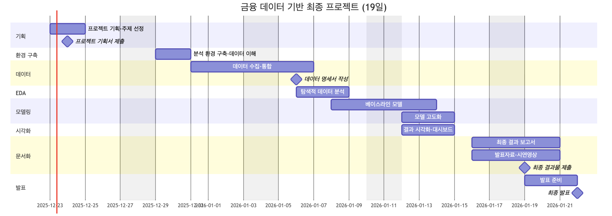

# 프로젝트 진행 체크리스트

과정 진행 중 팀이 루트 README에 두고 쓰던 체크리스트를 옮겨 온 기록이다. 일정은 과정 공식 가이드라인(`docs/5_파이널 프로젝트 일자별 가이드라인.docx`)을 따른다. 체크 표시는 README에서 마지막으로 갱신된 상태(2026-01-08) 그대로이며, 이후 단계의 완료 여부는 기록되지 않았다.

- 팀명: iM ONEderful
- 진행 기간: 2025.12.23 ~ 2026.01.22
- 운영 방식: 데일리 스탠드업, 버전 관리, 산출물 관리

## 1. 매일 공통 체크리스트

시작(아침)

- [ ] 팀 스탠드업: 오늘 목표 1~3개 확정
- [ ] 역할 확인 (PM, 전처리, 모델, 시각화, 문서)
- [ ] 작업 파일·버전·경로 확인 (충돌 방지)

마감(퇴근 전)

- [ ] 오늘 성과 공유 (팀 마무리 미팅)
- [ ] 일일진행일지 작성
- [ ] 백업 (USB, 클라우드/Git)
- [ ] 내일 할 일 3개 확정

## 2. 구간별 체크리스트

### 1~2일차 (12/23~12/24): 기획, 주제 선정

- [x] 주제 확정 (단일 심화 / 복합)
- [x] 연구 목적·범위·성과지표(KPI) 확정
- [x] 팀 역할 분담 확정
- [x] 프로젝트 기획서 초안 → 최종본 완료
- [x] 기획서 제출 완료 (변경 불가)

산출물: [x] 프로젝트 기획서, [x] 일일진행일지

### 3~4일차 (12/29~12/30): 환경 구축, 데이터 이해

- [x] 분석 환경 구축 (라이브러리·버전 통일)
- [x] 데이터 로딩 및 구조 파악 (테이블, 키, 기간)
- [x] 결측치·이상치 1차 점검
- [x] 추가 데이터 수집 필요 목록 작성
- [x] 세부 연구 질문·가설 정리
- [x] 벤치마킹·선행 사례 정리

산출물: [x] 일일진행일지

### 5~7일차 (12/31~01/06 오전): 데이터 수집·통합, 데이터 명세서

- [x] 데이터 수집 및 통합 (무결성, 중복, 키 점검)
- [x] 변수 정의·타입·범위·분포 정리
- [x] 결측·이상치 처리 기준 확정
- [x] 파생변수 후보 정의
- [x] 데이터 명세서 작성 완료

산출물: [x] 데이터 명세서, [x] 일일진행일지

### 7~9일차 (01/06 오후~01/08 오전): EDA

- [ ] 핵심 변수 기술통계 산출
- [ ] 그룹별 비교 (지역, 업종, 등급 등)
- [ ] 상관·연관성 분석 (히트맵 포함)
- [ ] 주요 인사이트 3~5개 도출 (그래프와 한 줄 해석)
- [ ] 다음 단계(모델링·검정) 방향 확정

산출물: [ ] 일일진행일지

### 9~11일차 (01/08 오후~01/12 오전): 베이스라인 모델과 검증

- [ ] 문제 정의 (분류 / 회귀 / 시계열 / 추천)
- [ ] 평가지표 확정 (F1, AUC, RMSE, Precision@K 등)
- [ ] 데이터 분할 전략 확정 (누수 여부 포함)
- [ ] 전처리 파이프라인 구축 (인코딩, 스케일링 등)
- [ ] 베이스라인 모델 결과 확보
- [ ] 실험 로그 정리 (모델, 파라미터, 성능)

산출물: [ ] 일일진행일지

### 11~13일차 (01/12 오후~01/14): 모델 개선, 시각화·인사이트

- [ ] 피처 엔지니어링 (파생, 변환, 선택)
- [ ] 모델 개선 (튜닝, 앙상블 등)
- [ ] 모델 비교표 작성 (베이스라인 대비)
- [ ] 핵심 시각화 제작
- [ ] 액션 아이템·비즈니스 제언 정리

산출물: [ ] 일일진행일지

### 14~16일차 (~01/19 오전): 문서화 (보고서, PPT, 시연)

- [ ] 최종보고서 목차·구조 확정
- [ ] 보고서 작성 완료 (배경~제언)
- [ ] PPT 스토리라인과 슬라이드 구성 완료
- [ ] 시연 영상 제작 완료 (가이드 준수)
- [ ] 최종 결과물 제출 (보고서, PPT, 시연 영상)

산출물: [ ] 최종 결과 보고서, [ ] 발표 자료 PPT, [ ] 시연 영상, [ ] 일일진행일지

### 16~19일차 (01/19 오후~01/22 오전): 발표 준비

- [ ] 발표 1차 리허설 (시간 엄수)
- [ ] 피드백 반영 (PPT 오류, 스토리 개선)
- [ ] Q&A 시나리오 준비
- [ ] 발표 2차 리허설
- [ ] 발표 파일 최종 백업 (USB, 클라우드)

산출물: [ ] 일일진행일지

### 19일차 (01/22): 최종 발표와 평가

- [ ] 장비 점검 (HDMI, 마이크, 화면 비율)
- [ ] 발표 리허설 30분 1회
- [ ] 최종 발표
- [ ] 프로젝트 평가지 작성
- [ ] 전체 파일 제출 (코드, 문서, 자료)

산출물: [ ] 프로젝트 평가지

## 3. 주요 마감 일정

| 날짜 | 시간 | 마감 내용 |
|------|------|-----------|
| 2025-12-24 (수) | 18:00 | 프로젝트 기획서 제출 (변경 불가) |
| 2026-01-19 (월) | 13:00 | 보고서, PPT, 시연 영상 제출 |
| 2026-01-22 (목) | 17:50 | 평가지 제출 |
| 2026-01-22 (목) | 22:00 | 전체 파일(코드 포함) 제출 |
